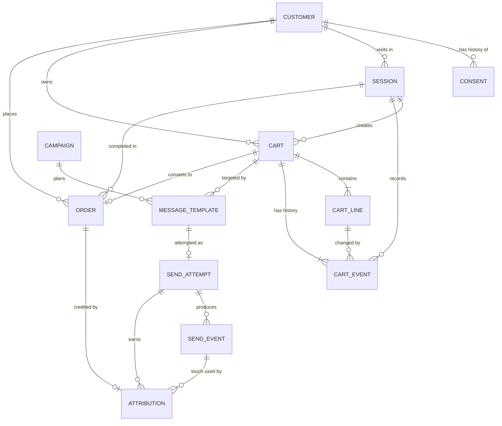

# Entity Relationship Diagram

## Relationships and cardinality

| Parent | Child | Cardinality | Optional? | Foreign key |
|---|---|---|---|---|
| Customer | Consent | 1:N | a customer may have no consent rows (treated as no consent) | Consent.customer_id |
| Customer | Session | 1:N | yes | Session.customer_id |
| Customer | Cart | 1:N | yes | Cart.customer_id |
| Session | Cart | 1:N | yes | Cart.session_id |
| Cart | CartLine | 1:N | no, at least one line | CartLine.cart_id |
| Cart | CartEvent | 1:N | no, at least cart_created | CartEvent.cart_id |
| Session | CartEvent | 1:N | yes | CartEvent.session_id |
| CartLine | CartEvent | 1:N | yes, only for line events | CartEvent.cart_line_id |
| Campaign | MessageTemplate | 1:N | yes | MessageTemplate.campaign_id |
| Cart | MessageTemplate | 1:N | yes, up to 3 per cart | MessageTemplate.cart_id |
| MessageTemplate | SendAttempt | 1:0..1 | yes | SendAttempt.message_id |
| SendAttempt | SendEvent | 1:N | yes, none if suppressed | SendEvent.send_id |
| Cart | Order | 1:0..1 | yes, most carts are never bought | Order.cart_id |
| Customer | Order | 1:N | yes | Order.customer_id |
| Session | Order | 1:N | yes | Order.session_id |
| Order | Attribution | 1:0..1 | yes, none for late or unattributed orders | Attribution.order_id |
| SendAttempt | Attribution | 1:N | yes | Attribution.send_id |
| SendEvent | Attribution | 1:N | yes | Attribution.send_event_id |

## Many-to-many relationships

There are none, so no bridge table is needed. Campaign and Cart would be many-to-many in a generic design, but MessageTemplate is a per-cart, per-campaign row (ID MSG-<cart-id>-NN), and it already plays the role of the link between them.

## Effective dates and lifecycle states

| Entity | Effective dating | Lifecycle |
|---|---|---|
| Consent | effective_from (end is derived from the next row) | opt_in <-> opt_out, alternating per customer and channel |
| Campaign | start_date, end_date | draft -> active -> completed, or cancelled |
| Cart | created_at, abandoned_at | active -> abandoned -> recovered, or active -> purchased |
| Order | placed_at | placed or cancelled |

## History is never overwritten

State changes are stored as new rows in Consent, CartEvent, SendAttempt and SendEvent. Cart.status and Cart.cart_total are current-state fields derived from those events and lines.

## Join validation

validate.py will check that every foreign key in the table above points to an existing parent row. It will also check these cross-table rules:
- Cart.session_id belongs to the same customer as Cart.customer_id.
- Order.customer_id matches its cart's customer.
- Attribution.send_event_id belongs to Attribution.send_id.